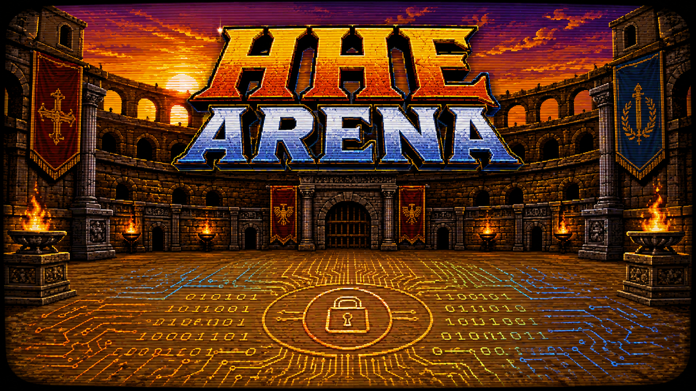

# HHE-ARENA

  

HHE-ARENA is a multi-language collection of Hybrid Homomorphic Encryption implementations plus shared tools for reproducible measurement, manifest-driven execution, schema validation, and paper-ready reports.

## Start here

New users should follow **[Getting started from scratch](docs/getting-started.md)**. It covers cloning the repository, prerequisites, Docker and native setup, the hhe CLI, manifests, safe functional checks, benchmark collection, reports, troubleshooting, and the HHELand Rubato example.

Contributors adding an implementation should follow **[Adding a new scheme or framework](docs/adding-a-scheme.md)**.

Quick tooling smoke check:

    git clone https://github.com/hosseinabdinf/HHE-ARENA.git
    cd HHE-ARENA
    docker build -t hhe-arena:tooling .
    docker run --rm hhe-arena:tooling probe
    docker run --rm hhe-arena:tooling --help

The base Docker image contains common tooling but intentionally no HE executable. Frameworks have independent dependencies and build instructions. Do not run repository-wide test or benchmark commands: some HE workloads require large memory and hours.

## Repository map

- frameworks/: independent HHE, transciphering, and reference implementations
- benchmarking-utilities/: C/C++, Go, Python, Rust harnesses; Go CLI; report generator
- schemas/: benchmark JSONL and dispatch-manifest contracts
- manifests/: example CLI manifests
- docs/: user, contributor, Docker, CLI, and schema documentation
- security_level_normalization.md: HHE-128 normalization method
- repo_readme_references_section.md: upstream implementations and libraries

## Framework families

- AES: BtR, FbT, FFT-CBS, Fregata, Full-LUT, Hippogryph, P-encoding, OpenSSL, and TinyAES
- Elisabeth
- Fasta
- FiLIP: independent-PTX, Rust, and Sorting Hat variants
- FRAST
- HHE Framework: Pasta/Pasta2 and related ciphers/backends
- HHELand
- Margrethe
- Transistor
- Trivium/Kreyvium
- YuX

See each framework README for its supported host, libraries, build, licensing, parameters, and expensive-run warnings.

## Common workflow

1. Build one framework executable without running a broad suite.
2. Register the executable as a concrete job in a version-1 manifest.
3. Inspect it with hhe list and hhe bench --dry-run.
4. Run a small warn-policy functional check.
5. On a suitable Linux host, pass strict preflight and collect isolated raw JSONL.
6. Validate and generate CSV, LaTeX, and pgfplots artifacts with the report generator.

Detailed references:

- [Getting started](docs/getting-started.md)
- [CLI and manifests](docs/orchestrator.md)
- [Docker and host requirements](docs/docker.md)
- [Benchmark record semantics](docs/benchmark_schema.md)
- [Adding a scheme](docs/adding-a-scheme.md)
- [Framework and cipher migration status](docs/status.md)
- [Report generator](benchmarking-utilities/report/README.md)

## Licenses and citations

Implementations retain their respective upstream licenses. Consult framework-local license and README files before use or redistribution. Cite the relevant paper and upstream implementation for every framework used; see repo_readme_references_section.md.
